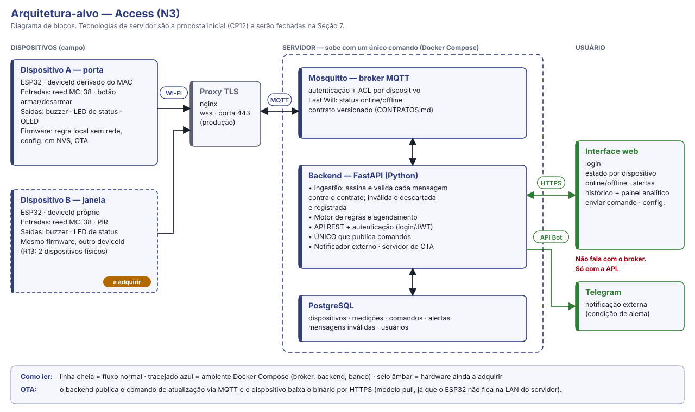
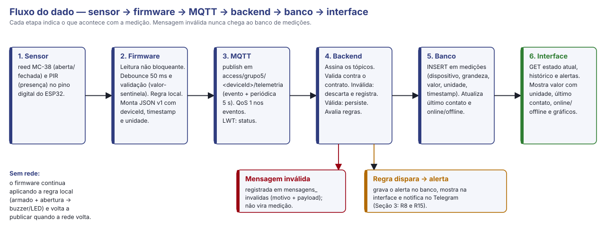
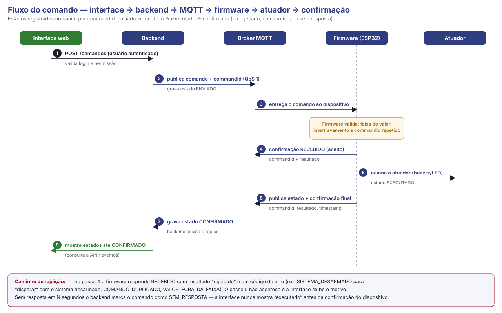

# CP12 — Proposta de upgrade do projeto N1

**Internet das Coisas · Aula 12 — Hardware, firmware-base e contratos · Prof. Edson Vaz Lopes**

| | |
|---|---|
| **Equipe (nº e nome)** | 05 — Access (Grupo 5) |
| **Projeto (N1 → N3)** | Access — controle de acesso e presença: detecção de abertura não autorizada de portas e janelas |
| **Integrantes** | Lucas Honorato dos Santos · Miguel Angel Balladares Huertas · Miguel Angelo Dufloth Filho · Gustavo Franz · Leonardo Lotério de Lima · Adrian Marcio Roth |
| **Data / Versão** | 20/10/2026 · v1.0 **parcial** (seções 1 a 4; as seções 5 a 9 entram na Aula 13, 27/10) |
| **Repositório** | <https://github.com/migueldufloth/access> |

---

## 1. Ponto de partida: o projeto da N1

| | |
|---|---|
| **Problema e usuário** | **Problema:** a falta de monitoramento automatizado e em tempo real da abertura de portas, janelas e compartimentos restritos dificulta a detecção rápida de acessos não autorizados. **Usuário:** administradores de segurança, gestores de TI e proprietários de salas de servidores, escritórios, almoxarifados e residências, que precisam ser avisados na hora e controlar o estado do alarme à distância. |
| **O que funcionou na N1** | • Detecção de abertura e fechamento com o sensor magnético MC-38 (borda + debounce de 50 ms), contador de aberturas e painel local no OLED. • Wi-Fi com reconexão automática não bloqueante (queda provocada e testada no CP06). • MQTT sobre WebSocket Secure (`wss`, porta 443) com TLS validado, hora sincronizada por SNTP e Last Will (`online`/`offline`). • Broker Mosquitto com autenticação e ACL por usuário, atrás de nginx; credenciais fora do Git (`secrets.h`, `config.js`). • Telemetria periódica (5 s) e por evento; comando remoto (`armar`, `desarmar`, `disparar`, `silenciar`) com confirmação (`aplicado` verdadeiro ou falso) e recusa de `disparar` com o sistema desarmado. • Modo degradado: sem contato com o broker por 30 s, o alarme volta a ser decidido pelo sensor. • Painel web com estado, idade da telemetria, online/offline e botões de comando. |
| **Limitações conhecidas** | • **Uma só entrada física** (reed MC-38). O botão de armar/desarmar e o LED de status da versão 1 não foram reintegrados. • **Sem backend, banco nem histórico.** O painel fala direto com o broker; nada é gravado. • **A decisão de disparar roda no navegador.** Com o painel fechado e o broker online, a abertura da porta não aciona o buzzer. • **Senha do usuário do painel (`access_web`) visível no navegador** (`config.js`); a ACL só limita o dano a forjar comando. • **Contrato informal:** a telemetria não traz versão, deviceId, timestamp nem unidade; o comando é texto puro, sem `commandId`; a confirmação não referencia o comando; tudo em QoS 0. • **Firmware:** parâmetros fixos em `config.h`; o estado "armado" não persiste (sobe desarmado); o boot depende de rede (espera de SNTP sem limite de tempo); falha de sensor não é detectada. • **Um único dispositivo**; tópicos sem deviceId. • Broker roda direto no host, sem container; sem testes automatizados, sem CI, sem OTA. |
| **Proposta de valor** | O Access avisa em segundos, no painel e no celular, que uma porta ou janela que deveria estar fechada foi aberta, e permite armar, desarmar e acionar a sirene de qualquer lugar — com histórico de cada abertura e a confirmação de que o dispositivo cumpriu o comando. É barato (ESP32 + sensor magnético), instala sem obra, continua alarmando localmente se a internet cair e tem todo o código e as regras abertos para inspeção. Para quem hoje não tem nenhum monitoramento de acesso, passa a ter registro e alerta imediatos. |

**Pedido de troca de projeto:** ☐ Sim  ☒ **Não.**
O projeto da N1 comporta o upgrade: mantém o mesmo problema e o mesmo usuário, e as lacunas acima são exatamente as camadas que a N3 pede (backend, banco, interface com histórico, segunda entrada, segundo dispositivo, decisão remota). Não há motivo para trocar.

---

## 2. Upgrade por camada

| Camada | Como era na N1 | Como será na N3 |
|---|---|---|
| **Hardware** | 1 ESP32 (Kit V1 ESP-WROOM-32); reed MC-38 no GPIO 4; buzzer no GPIO 25 (GPIO 18 mantido em LOW como terra); OLED I²C (GPIO 21/22). Botão e LED da v1 não reintegrados. Montagem em protoboard, alimentação por micro-USB. | **2 dispositivos físicos** (R13). **A — porta:** reed + botão armar/desarmar, buzzer, LED de status, OLED. **B — janela/ambiente:** reed + PIR HC-SR501, buzzer, LED de status. Segundo ESP32 a adquirir. Atuadores com proteção e alimentação dimensionadas (calculadas na Seção 5), esquema elétrico, BOM e mapa de pinos no repositório, caixa para acabamento. |
| **Firmware** | Arduino, `Access.ino` + `config.h`. Leitura com debounce, reconexão de Wi-Fi e MQTT, dashboard OLED, modo degradado. Parâmetros fixos no código; estado "armado" volátil; boot bloqueia esperando SNTP. | Reorganizado em módulos (rede, sensores, alarme, display, configuração, OTA). **Regra local** que funciona sem rede (armado + abertura sem desarme no tempo de entrada → buzzer/LED). **Configuração persistente em NVS** (estado armado, tempo de entrada, intervalo de telemetria) alterável por comando. **Estado seguro** definido. Boot sem depender da rede. `deviceId` e timestamp (ou indicação de hora não sincronizada) em toda mensagem. Validação além do debounce e detecção de falha de sensor. `commandId` e intertravamento. **OTA.** |
| **Comunicação (MQTT)** | 4 tópicos fixos em `access/grupo5/…`, sem deviceId. Telemetria em JSON sem versão, timestamp nem unidade. Comando em texto puro; confirmação sem `commandId`. QoS 0. TLS (`wss`) e Last Will já existem. | **Contrato versionado (`CONTRATOS.md`)** com árvore por dispositivo (`access/grupo5/<deviceId>/…`: telemetria, estado, comando, confirmação, status com Last Will). JSON com versão, `deviceId`, timestamp e unidades; comandos com `commandId`; confirmação com resultado e código de erro; QoS e retain justificados por tópico (QoS 1 em comando e confirmação). ACL por dispositivo. v0 no CP12, congelado como v1 na Aula 13. |
| **Backend** | *(não existia)* | Serviço em **Python/FastAPI** (proposta): assina os tópicos, valida cada mensagem contra o contrato (descarta e registra as inválidas), persiste, aplica regras, notifica e expõe a API REST usada pela interface. É o **único** que publica comandos e também serve o binário do OTA. |
| **Banco de dados** | *(não existia)* | **PostgreSQL** (proposta), consultável na demonstração. Tabelas previstas: `dispositivos`, `medicoes` (dispositivo, grandeza, valor, unidade, timestamp), `comandos` (commandId, origem, ação, enviado em, resultado, confirmado em), `alertas`, `mensagens_invalidas`, `usuarios`. Esquema versionado no repositório (script ou migração). |
| **Interface** | Painel estático (`mqtt.js`) que assina e publica direto no broker, com a senha no navegador. Sem histórico, sem login, sem alertas persistentes. OLED local. | Aplicação web que fala **somente com a API**. Login; estado atual por dispositivo, com unidade; último contato; online/offline; alertas ativos; histórico (tabela e gráfico); painel analítico (R14); envio de comando com os estados enviado → recebido → executado → confirmado e motivo da rejeição; alteração de configuração. Identidade visual própria (nome, cores, ícones). |
| **Decisão/regra** | A regra "porta abriu com sistema armado → `disparar`" roda **no navegador**; no firmware só existe o modo degradado após 30 s sem broker. | **Duas camadas.** *Local (firmware):* armado + abertura sem desarme no tempo de entrada → alarme local, com ou sem rede. *Remota (backend):* abertura com sistema armado persistente por mais de N s → registra alerta, notifica no Telegram e gera comando `disparar` com o mesmo ciclo do R7; mais um **agendamento** de armar/desarmar (ex.: armar às 22h, desarmar às 6h, configurável). |

---

## 3. Conferência contra o piso R1–R18

Legenda: **Já existe** = herdado da N1 (conferido no repositório); **Falta** = o que a N3 precisa entregar; **Pendência** = ainda sem definição fechada.

| Req. | Como o projeto vai atender |
|---|---|
| **R1** Hardware | **Já existe:** ESP32, reed MC-38 e buzzer reais, OLED. **Falta:** segunda entrada de tipo diferente (botão no dispositivo A; PIR no B), LED de status, atuador com proteção e alimentação dimensionadas, esquema, BOM e mapa de pinos em `hardware/` (hoje vazio), caixa. **Pendência:** como acionar o buzzer sem carga direta no GPIO será calculado na Seção 5. |
| **R2** Firmware | **Já existe:** leitura não bloqueante com debounce de 50 ms, reconexão de Wi-Fi e broker (reassina ao reconectar), SNTP, Last Will, logs no Serial, id pelo MAC, modo degradado. **Falta:** configuração persistente em NVS, regra local plena sem rede, estado seguro definido, validação de faixa/sentinela e detecção de falha de sensor, boot sem bloqueio por SNTP, timestamp nas mensagens. |
| **R3** Contrato MQTT | **Já existe:** tabela de tópicos no README e Last Will. **Falta:** `CONTRATOS.md` com árvore por dispositivo, um JSON por tópico com versão, `deviceId`, timestamp e unidades, lista de comandos e faixas, confirmação com `commandId`, catálogo de erros, QoS e retain justificados. v0 hoje, congelado como v1 na Aula 13. |
| **R4** Backend | **Falta (não existe):** FastAPI que assina os tópicos, valida contra o contrato, descarta e registra o inválido, persiste e expõe a API (estado atual, histórico, comando). Será o único publicador de comandos; a interface deixa de falar com o broker. |
| **R5** Banco de dados | **Falta (não existe):** PostgreSQL com histórico de medições e registro de comandos (commandId, origem, ação, horários, resultado), mais alertas, mensagens inválidas e usuários; esquema versionado no repositório. |
| **R6** Interface | **Já existe:** estado da porta, idade da telemetria, online/offline, botões de comando (no painel atual). **Falta:** valor com unidade, histórico, alertas ativos, login, alteração de configuração, e passar a consumir só a API. |
| **R7** Ciclo de comando | **Já existe:** confirmação com `aplicado` verdadeiro/falso e recusa de `disparar` desarmado. **Falta:** `commandId`, os quatro estados registrados no banco (enviado, recebido, executado, confirmado), motivo da rejeição, tratamento de comando desconhecido ou duplicado (hoje o desconhecido é ignorado em silêncio) e estado "sem resposta". |
| **R8** Decisão remota | **Falta (hoje a regra está no navegador):** regra no backend — entrada: telemetria com porta aberta e sistema armado; condição: persistir além de N s (configurável); efeito: alerta + Telegram + comando `disparar` com o ciclo do R7. Mais agendamento de armar/desarmar. A especificação completa fecha até a Aula 13. |
| **R9** Segurança básica | **Já existe:** credenciais de Wi-Fi e broker fora do Git (`secrets.h`, `config.js` no `.gitignore`). **Falta:** login com usuário e senha (senha com hash) e token na API; rotas de comando só para autenticado; `.env` para backend e banco; eliminar a senha do broker no navegador. |
| **R10** Falhas testadas | **Já existe:** evidência da queda de Wi-Fi com reconexão (CP06). **Falta:** documentar e testar os quatro cenários — (1) queda do Wi-Fi, (2) broker indisponível, (3) falha de sensor, (4) comando inválido/duplicado — cada um com como provocar, esperado, observado e evidência (`docs/`). **Pendência:** definir como detectar sensor reed desconectado (hoje o fio solto lê "aberta"). |
| **R11** Entrega executável | **Já existe:** README com execução do firmware e do broker, tags `cp06` e `v3`. **Falta:** README para subir o sistema inteiro (pré-requisitos, `.env.example`, compose, gravação do firmware), tag/release da versão defendida e commits de todos os integrantes. |
| **R12** Orquestração | **Falta (não existe):** `compose.yaml` com broker, backend e banco subindo com um comando e variáveis em `.env`. Hoje o broker roda no host, sem container; a configuração em `broker/mosquitto/` será reaproveitada. O TLS/proxy será opcional para o compose funcionar sem domínio nem certificado. |
| **R13** Múltiplos dispositivos | **Falta (não existe):** dois ESP32 físicos, cada um com `deviceId` próprio, distinguidos no backend e na interface. **Pendência:** o segundo ESP32 ainda não foi adquirido; aquisição prevista antes da primeira aula de construção (10/11) — a confirmar. |
| **R14** Painel analítico | **Falta (não existe):** gráficos de histórico real — aberturas por hora/dia, tempo em alarme, uptime por dispositivo e média móvel. Ferramenta (biblioteca de gráficos na própria interface ou Grafana) a fechar na Seção 7. |
| **R15** Notificação externa | **Falta (não existe hoje):** o `ntfy.sh` usado na v2 foi removido do firmware. A N3 notifica pelo backend, via Telegram (proposta), quando ocorre alerta de abertura com sistema armado ou dispositivo offline. |
| **R16** Segurança avançada | **Já existe:** TLS no MQTT (`wss`, certificado Let's Encrypt validado pelo cliente) e ACL por usuário (dispositivo × painel). **Falta:** ACL por dispositivo e, para reforçar, perfis na API (operador só visualiza; administrador comanda). |
| **R17** OTA | **Falta (não existe):** atualização remota por HTTPS — o backend publica um comando de atualização e o ESP32 baixa o binário (modelo pull, pois o dispositivo não está na LAN do servidor). **Pendência:** mecanismo definitivo e tabela de partições a confirmar na Aula 13. |
| **R18** Testes e CI | **Falta (não existe):** testes automatizados do backend (validação de contrato e regra de decisão) com pytest e pipeline no GitHub Actions a cada push/PR. |

---

## 4. Arquitetura-alvo

Diagrama de blocos (arquivo versionado: `docs/cp12/diagramas/arquitetura-alvo.svg`). As tecnologias de servidor são a proposta inicial e são fechadas na Seção 7.

**Decisões de arquitetura que o diagrama carrega**

- O **backend é o único** componente que publica comando no dispositivo; a interface fala só com a API.
- O **firmware decide localmente** o alarme (regra local), de modo que a segurança não depende do painel aberto nem da internet; o backend acrescenta registro, notificação, escalonamento e agendamento.
- Tudo que fica no servidor (**broker, backend e banco**) sobe com um único comando (Docker Compose); o proxy TLS é opcional.
- Cada mensagem carrega **versão, `deviceId`, timestamp e unidade**; mensagem fora do contrato é descartada e registrada.

### Fluxo do dado

Arquivo versionado: `docs/cp12/diagramas/fluxo-dado.svg`.

1. **Sensor:** o reed (aberta/fechada) e o PIR (presença) chegam a pinos digitais do ESP32.
2. **Firmware:** leitura não bloqueante, debounce de 50 ms e validação; aplica a regra local; monta o JSON (versão, `deviceId`, timestamp, valor e unidade).
3. **MQTT:** publica em `access/grupo5/<deviceId>/telemetria` (por evento e a cada 5 s); o status online/offline sai pelo Last Will.
4. **Backend:** assina os tópicos e valida cada mensagem contra o contrato; a inválida é descartada e registrada em `mensagens_invalidas`; a válida é persistida e avaliada pelas regras.
5. **Banco:** grava a medição (dispositivo, grandeza, valor, unidade, timestamp) e atualiza último contato e online/offline.
6. **Interface:** consulta a API para estado atual, histórico e alertas; mostra valor com unidade, último contato, online/offline e gráficos. Quando uma regra dispara, o alerta é gravado, exibido e notificado no Telegram.

### Fluxo do comando

Arquivo versionado: `docs/cp12/diagramas/fluxo-comando.svg`.

1. **Interface → backend:** o usuário autenticado envia o comando (`POST /comandos`); o backend valida login e permissão.
2. **Backend → MQTT:** gera o `commandId`, grava o estado **enviado** e publica o comando (QoS 1) no tópico do dispositivo.
3. **MQTT → firmware:** o broker entrega o comando ao dispositivo correto.
4. **Firmware valida:** faixa do valor, intertravamento (ex.: `disparar` com o sistema desarmado) e `commandId` repetido. Responde **recebido** (aceito ou rejeitado, com código de erro e motivo).
5. **Atuador:** se aceito, o firmware aciona o buzzer/LED e passa ao estado **executado**.
6. **Firmware → MQTT:** publica o estado atual e a confirmação final com `commandId`, resultado e timestamp.
7. **Backend:** assina o tópico e grava **confirmado**. Sem resposta em N segundos, marca **sem resposta**.
8. **Interface:** exibe cada estado até a confirmação; comando rejeitado mostra o motivo. A interface nunca mostra "executado" antes da confirmação do dispositivo.

---

*As seções 5 a 9 (hardware calculado, firmware em fluxograma, contrato v0/v1, tecnologias, cronograma, riscos, divisão de responsabilidades e repositório) serão entregues na Aula 13 (27/10/2026).*
