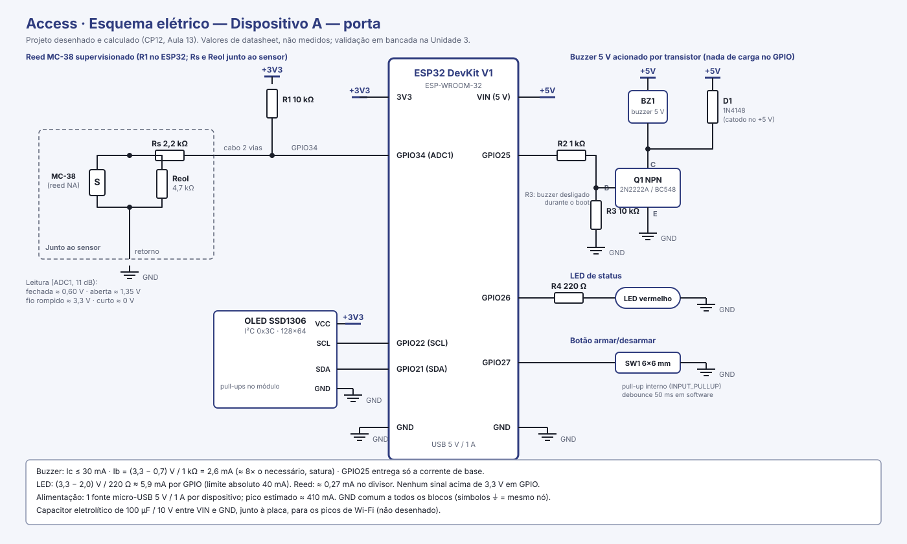
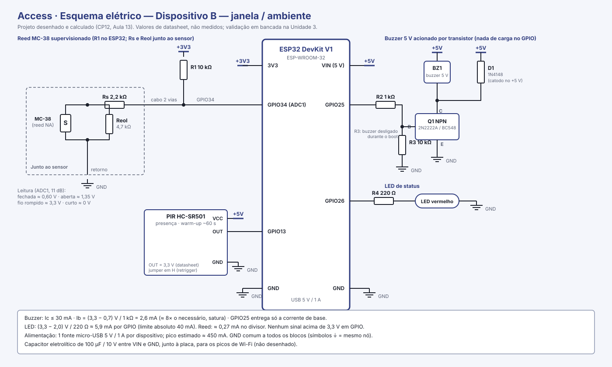
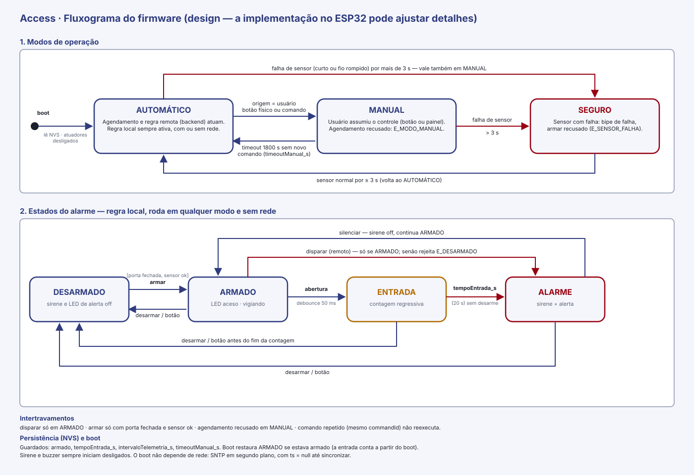
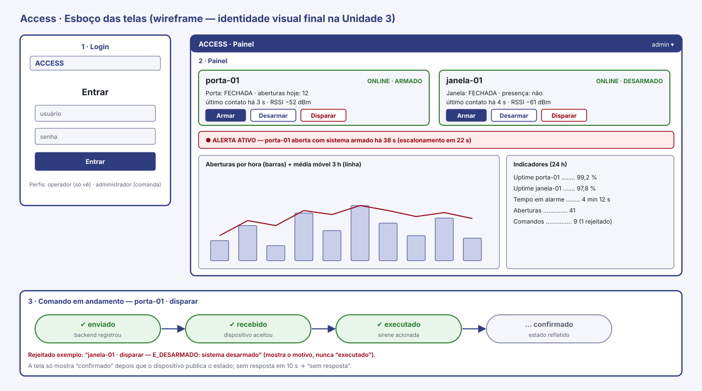

# CP12 — Proposta de upgrade do projeto N1

**Internet das Coisas · Aula 12 — Hardware, firmware-base e contratos · Prof. Edson Vaz Lopes**

| | |
|---|---|
| **Equipe (nº e nome)** | 05 — Access (Grupo 5) |
| **Projeto (N1 → N3)** | Access — controle de acesso e presença: detecção de abertura não autorizada de portas e janelas |
| **Integrantes** | Lucas Honorato dos Santos · Miguel Angel Balladares Huertas · Miguel Angelo Dufloth Filho · Gustavo Franz · Leonardo Lotério de Lima · Adrian Marcio Roth |
| **Data / Versão** | 27/10/2026 · v1.0 **completa** (seções 1 a 9 e anexos) |
| **Repositório** | <https://github.com/migueldufloth/access> |

---

## 1. Ponto de partida: o projeto da N1

| | |
|---|---|
| **Problema e usuário** | **Problema:** a falta de monitoramento automatizado e em tempo real da abertura de portas, janelas e compartimentos restritos dificulta a detecção rápida de acessos não autorizados. **Usuário:** administradores de segurança, gestores de TI e proprietários de salas de servidores, escritórios, almoxarifados e residências, que precisam ser avisados na hora e controlar o estado do alarme à distância. |
| **O que funcionou na N1** | • Detecção de abertura e fechamento com o sensor magnético MC-38 (borda + debounce de 50 ms), contador de aberturas e painel local no OLED.<br>• Wi-Fi com reconexão automática não bloqueante (queda provocada e testada no CP06).<br>• MQTT sobre WebSocket Secure (`wss`, porta 443) com TLS validado, hora sincronizada por SNTP e Last Will (`online`/`offline`).<br>• Broker Mosquitto com autenticação e ACL por usuário, atrás de nginx; credenciais fora do Git (`secrets.h`, `config.js`).<br>• Telemetria periódica (5 s) e por evento; comando remoto (`armar`, `desarmar`, `disparar`, `silenciar`) com confirmação (`aplicado` verdadeiro ou falso) e recusa de `disparar` com o sistema desarmado.<br>• Modo degradado: sem contato com o broker por 30 s, o alarme volta a ser decidido pelo sensor.<br>• Painel web com estado, idade da telemetria, online/offline e botões de comando. |
| **Limitações conhecidas** | • **Uma só entrada física** (reed MC-38). O botão de armar/desarmar e o LED de status da versão 1 não foram reintegrados.<br>• **Sem backend, banco nem histórico.** O painel fala direto com o broker; nada é gravado.<br>• **A decisão de disparar roda no navegador.** Com o painel fechado e o broker online, a abertura da porta não aciona o buzzer.<br>• **Senha do usuário do painel (`access_web`) visível no navegador** (`config.js`); a ACL só limita o dano a forjar comando.<br>• **Contrato informal:** a telemetria não traz versão, deviceId, timestamp nem unidade; o comando é texto puro, sem `commandId`; a confirmação não referencia o comando; tudo em QoS 0.<br>• **Firmware:** parâmetros fixos em `config.h`; o estado "armado" não persiste (sobe desarmado); o boot depende de rede (espera de SNTP sem limite de tempo); falha de sensor não é detectada.<br>• **Um único dispositivo**; tópicos sem deviceId.<br>• Broker roda direto no host, sem container; sem testes automatizados, sem CI, sem OTA. |
| **Proposta de valor** | O Access avisa em segundos, no painel e no celular, que uma porta ou janela que deveria estar fechada foi aberta, e permite armar, desarmar e acionar a sirene de qualquer lugar — com histórico de cada abertura e a confirmação de que o dispositivo cumpriu o comando. É barato (ESP32 + sensor magnético), instala sem obra, continua alarmando localmente se a internet cair e tem todo o código e as regras abertos para inspeção. Para quem hoje não tem nenhum monitoramento de acesso, passa a ter registro e alerta imediatos. |

**Pedido de troca de projeto:** ☐ Sim  ☒ **Não.**
O projeto da N1 comporta o upgrade: mantém o mesmo problema e o mesmo usuário, e as lacunas acima são exatamente as camadas que a N3 pede (backend, banco, interface com histórico, segunda entrada, segundo dispositivo, decisão remota). Não há motivo para trocar.

---

## 2. Upgrade por camada

| Camada | Como era na N1 | Como será na N3 |
|---|---|---|
| **Hardware** | 1 ESP32 (Kit V1 ESP-WROOM-32); reed MC-38 no GPIO 4; buzzer no GPIO 25 (GPIO 18 mantido em LOW como terra); OLED I²C (GPIO 21/22). Botão e LED da v1 não reintegrados. Montagem em protoboard, alimentação por micro-USB. | **2 dispositivos físicos** (R13). **A — porta:** reed + botão armar/desarmar, buzzer, LED de status, OLED. **B — janela/ambiente:** reed + PIR HC-SR501, buzzer, LED de status. Segundo ESP32 a adquirir. Atuadores com proteção e alimentação dimensionadas (calculadas na Seção 5), esquema elétrico, BOM e mapa de pinos no repositório, caixa para acabamento. |
| **Firmware** | Arduino, `Access.ino` + `config.h`. Leitura com debounce, reconexão de Wi-Fi e MQTT, dashboard OLED, modo degradado. Parâmetros fixos no código; estado "armado" volátil; boot bloqueia esperando SNTP. | Reorganizado em módulos (rede, sensores, alarme, display, configuração, OTA). **Regra local** que funciona sem rede (armado + abertura sem desarme no tempo de entrada → buzzer/LED). **Configuração persistente em NVS** (estado armado, tempo de entrada, intervalo de telemetria) alterável por comando. **Estado seguro** definido. Boot sem depender da rede. `deviceId` e timestamp (ou indicação de hora não sincronizada) em toda mensagem. Validação além do debounce e detecção de falha de sensor. `commandId` e intertravamento. **OTA.** |
| **Comunicação (MQTT)** | 4 tópicos fixos em `access/grupo5/…`, sem deviceId. Telemetria em JSON sem versão, timestamp nem unidade. Comando em texto puro; confirmação sem `commandId`. QoS 0. TLS (`wss`) e Last Will já existem. | **Contrato versionado (`CONTRATOS.md`)** com árvore por dispositivo (`access/grupo5/<deviceId>/…`: telemetria, estado, comando, confirmação, status com Last Will). JSON com versão, `deviceId`, timestamp e unidades; comandos com `commandId`; confirmação com resultado e código de erro; QoS e retain justificados por tópico (QoS 1 em comando e confirmação). ACL por dispositivo. v0 no CP12, congelado como v1 na Aula 13. |
| **Backend** | *(não existia)* | Serviço em **Python/FastAPI**: assina os tópicos, valida cada mensagem contra o contrato (descarta e registra as inválidas), persiste, aplica regras, notifica e expõe a API REST usada pela interface. É o **único** que publica comandos e também serve o binário do OTA. |
| **Banco de dados** | *(não existia)* | **PostgreSQL**, consultável na demonstração. Tabelas previstas: `dispositivos`, `medicoes` (dispositivo, grandeza, valor, unidade, timestamp), `comandos` (commandId, origem, ação, enviado em, resultado, confirmado em), `alertas`, `mensagens_invalidas`, `usuarios`, `eventos_status` (base do uptime) e `agendamentos` (campos na Seção 7.2). Esquema versionado no repositório (script ou migração). |
| **Interface** | Painel estático (`mqtt.js`) que assina e publica direto no broker, com a senha no navegador. Sem histórico, sem login, sem alertas persistentes. OLED local. | Aplicação web que fala **somente com a API**. Login; estado atual por dispositivo, com unidade; último contato; online/offline; alertas ativos; histórico (tabela e gráfico); painel analítico (R14); envio de comando com os estados enviado → recebido → executado → confirmado e motivo da rejeição; alteração de configuração. Identidade visual própria (nome, cores, ícones). |
| **Decisão/regra** | A regra "porta abriu com sistema armado → `disparar`" roda **no navegador**; no firmware só existe o modo degradado após 30 s sem broker. | **Duas camadas.** *Local (firmware):* armado + abertura sem desarme no tempo de entrada → alarme local, com ou sem rede. *Remota (backend):* abertura com sistema armado persistente por mais de N s → registra alerta, notifica no Telegram e gera comando `disparar` com o mesmo ciclo do R7; mais um **agendamento** de armar/desarmar (ex.: armar às 22h, desarmar às 6h, configurável). |

---

## 3. Conferência contra o piso R1–R18

Legenda: **Já existe** = herdado da N1 (conferido no repositório); **Falta** = o que a N3 precisa entregar; **Pendência** = ainda sem definição fechada.

| Req. | Como o projeto vai atender |
|---|---|
| **R1** Hardware | **Já existe:** ESP32, reed MC-38 e buzzer reais, OLED. **Projetado (Seção 5):** segunda entrada de tipo diferente (botão no dispositivo A, PIR no B), LED de status, buzzer acionado por transistor NPN com diodo, alimentação dimensionada (pico ≈ 410 a 450 mA, fonte 5 V / 1 A), reed supervisionado, esquemas, BOM e mapa de pinos em [`hardware/`](../../hardware/). **Falta:** montar e medir na Unidade 3, a caixa de acabamento e o segundo ESP32. |
| **R2** Firmware | **Já existe:** leitura não bloqueante com debounce de 50 ms, reconexão de Wi-Fi e broker (reassina ao reconectar), SNTP, Last Will, logs no Serial, id pelo MAC, modo degradado. **Projetado (Seção 5.3), falta implementar:** configuração persistente em NVS, regra local plena sem rede, estado seguro definido, validação de faixa/sentinela e detecção de falha de sensor, boot sem bloqueio por SNTP, timestamp nas mensagens. |
| **R3** Contrato MQTT | **Já existe:** tabela de tópicos no README (contrato v0) e Last Will. **Entregue:** [`CONTRATOS.md`](../../CONTRATOS.md), **congelado como v1** em 27/10/2026, com árvore por dispositivo, um JSON por tópico (versão, `deviceId`, timestamp e unidades), lista de comandos e faixas, confirmação com `commandId`, catálogo de erros, QoS e retain justificados. **Falta:** implementar e validar no firmware e no backend. |
| **R4** Backend | **Falta (não existe):** FastAPI que assina os tópicos, valida contra o contrato, descarta e registra o inválido, persiste e expõe a API (estado atual, histórico, comando). Será o único publicador de comandos; a interface deixa de falar com o broker. |
| **R5** Banco de dados | **Falta (não existe):** PostgreSQL com histórico de medições e registro de comandos (commandId, origem, ação, horários, resultado), mais alertas, mensagens inválidas e usuários; esquema versionado no repositório. |
| **R6** Interface | **Já existe:** estado da porta, idade da telemetria, online/offline, botões de comando (no painel atual). **Falta:** valor com unidade, histórico, alertas ativos, login, alteração de configuração, e passar a consumir só a API. |
| **R7** Ciclo de comando | **Já existe:** confirmação com `aplicado` verdadeiro/falso e recusa de `disparar` desarmado. **Falta:** `commandId`, os quatro estados registrados no banco (enviado, recebido, executado, confirmado), motivo da rejeição, tratamento de comando desconhecido ou duplicado (hoje o desconhecido é ignorado em silêncio) e estado "sem resposta". |
| **R8** Decisão remota | **Falta (hoje a regra está no navegador):** regra no backend — entrada: telemetria com porta aberta e sistema armado; condição: persistir além de N s (configurável); efeito: alerta + Telegram + comando `disparar` com o ciclo do R7. Mais agendamento de armar/desarmar. Especificação completa (entrada, condição, efeito) no Anexo A. |
| **R9** Segurança básica | **Já existe:** credenciais de Wi-Fi e broker fora do Git (`secrets.h`, `config.js` no `.gitignore`). **Falta:** login com usuário e senha (senha com hash) e token na API; rotas de comando só para autenticado; `.env` para backend e banco; eliminar a senha do broker no navegador. |
| **R10** Falhas testadas | **Já existe:** evidência da queda de Wi-Fi com reconexão (CP06). **Falta:** documentar e testar os quatro cenários — (1) queda do Wi-Fi, (2) broker indisponível, (3) falha de sensor, (4) comando inválido/duplicado — cada um com como provocar, esperado, observado e evidência (`docs/`). Falha de sensor detectada por reed supervisionado por resistores (Seção 5.1); plano de testes no Anexo B. |
| **R11** Entrega executável | **Já existe:** README com execução do firmware e do broker, tags `cp06` e `v3`. **Falta:** README para subir o sistema inteiro (pré-requisitos, `.env.example`, compose, gravação do firmware), tag/release da versão defendida e commits de todos os integrantes. |
| **R12** Orquestração | **Falta (não existe):** `compose.yaml` com broker, backend e banco subindo com um comando e variáveis em `.env`. Hoje o broker roda no host, sem container; a configuração em `broker/mosquitto/` será reaproveitada. O TLS/proxy será opcional para o compose funcionar sem domínio nem certificado. |
| **R13** Múltiplos dispositivos | **Falta (não existe, projetado na Seção 5):** dois ESP32 físicos, cada um com `deviceId` próprio, distinguidos no backend e na interface. **Pendência:** o segundo ESP32 ainda não foi adquirido; aquisição prevista antes da primeira aula de construção (10/11) — a confirmar. |
| **R14** Painel analítico | **Falta (não existe):** gráficos de histórico real — aberturas por hora/dia, tempo em alarme, uptime por dispositivo e média móvel. Ferramenta: Chart.js na própria interface (Seção 7). |
| **R15** Notificação externa | **Falta (não existe hoje):** o `ntfy.sh` usado na v2 foi removido do firmware. A N3 notifica pelo backend, via Telegram (Bot API), quando ocorre alerta de abertura com sistema armado ou dispositivo offline. |
| **R16** Segurança avançada | **Já existe:** TLS no MQTT (`wss`, certificado Let's Encrypt validado pelo cliente) e ACL por usuário (dispositivo × painel). **Falta:** ACL por dispositivo e, para reforçar, perfis na API (operador só visualiza; administrador comanda). |
| **R17** OTA | **Falta (não existe):** atualização remota por HTTPS — o backend publica um comando de atualização e o ESP32 baixa o binário (modelo pull, pois o dispositivo não está na LAN do servidor). Mecanismo: `esp_https_ota` com HTTPS validado, SHA-256 conferido e rollback, em partições com dois slots OTA (Seções 6 e 7). |
| **R18** Testes e CI | **Falta (não existe):** testes automatizados do backend (validação de contrato e regra de decisão) com pytest e pipeline no GitHub Actions a cada push/PR. |

---

## 4. Arquitetura-alvo

Diagrama de blocos (arquivo versionado: `docs/cp12/diagramas/arquitetura-alvo.svg`). As tecnologias de servidor estão definidas e justificadas na Seção 7.


**Decisões de arquitetura que o diagrama carrega**

- O **backend é o único** componente que publica comando no dispositivo; a interface fala só com a API.
- O **firmware decide localmente** o alarme (regra local), de modo que a segurança não depende do painel aberto nem da internet; o backend acrescenta registro, notificação, escalonamento e agendamento.
- Tudo que fica no servidor (**broker, backend e banco**) sobe com um único comando (Docker Compose); o proxy TLS é opcional.
- Cada mensagem carrega **versão, `deviceId`, timestamp e unidade**; mensagem fora do contrato é descartada e registrada.

### Fluxo do dado

Arquivo versionado: `docs/cp12/diagramas/fluxo-dado.svg`.


1. **Sensor:** o reed (aberta/fechada) e o PIR (presença) chegam a pinos digitais do ESP32.
2. **Firmware:** leitura não bloqueante, debounce de 50 ms e validação; aplica a regra local; monta o JSON (versão, `deviceId`, timestamp, valor e unidade).
3. **MQTT:** publica em `access/grupo5/<deviceId>/telemetria` (por evento e a cada 5 s); o status online/offline sai pelo Last Will.
4. **Backend:** assina os tópicos e valida cada mensagem contra o contrato; a inválida é descartada e registrada em `mensagens_invalidas`; a válida é persistida e avaliada pelas regras.
5. **Banco:** grava a medição (dispositivo, grandeza, valor, unidade, timestamp) e atualiza último contato e online/offline.
6. **Interface:** consulta a API para estado atual, histórico e alertas; mostra valor com unidade, último contato, online/offline e gráficos. Quando uma regra dispara, o alerta é gravado, exibido e notificado no Telegram.

### Fluxo do comando

Arquivo versionado: `docs/cp12/diagramas/fluxo-comando.svg`.


1. **Interface → backend:** o usuário autenticado envia o comando (`POST /comandos`); o backend valida login e permissão.
2. **Backend → MQTT:** gera o `commandId`, grava o estado **enviado** e publica o comando (QoS 1) no tópico do dispositivo.
3. **MQTT → firmware:** o broker entrega o comando ao dispositivo correto.
4. **Firmware valida:** faixa do valor, intertravamento (ex.: `disparar` com o sistema desarmado) e `commandId` repetido. Responde **recebido** (aceito ou rejeitado, com código de erro e motivo).
5. **Atuador:** se aceito, o firmware aciona o buzzer/LED e passa ao estado **executado**.
6. **Firmware → MQTT:** publica o estado atual e a confirmação final com `commandId`, resultado e timestamp.
7. **Backend:** assina o tópico e grava **confirmado**. Sem resposta em N segundos, marca **sem resposta**.
8. **Interface:** exibe cada estado até a confirmação; comando rejeitado mostra o motivo. A interface nunca mostra "executado" antes da confirmação do dispositivo.

---

## 5. Hardware: desenho e dimensionamento

Sem bancada nesta etapa: tudo abaixo é **desenho e cálculo**, a partir de datasheet, e não medição. A N3 tem **dois dispositivos** (A: porta; B: janela/ambiente), cada um com sua fonte USB. Os esquemas elétricos estão versionados em [`hardware/`](../../hardware/):





### 5.1 Verificação elétrica (calculada)

| Verificação | Valor calculado/esperado | Como será garantido |
|---|---|---|
| Tensão no pino 3V3 e 5V/VIN usados | **3V3:** OLED ≈ 20 mA, divisor do reed ≈ 0,27 mA, mais o próprio ESP32 (≈ 350 mA de pico com Wi-Fi): ≈ 375 mA, abaixo dos 800 mA do regulador da placa. **VIN (5 V):** buzzer ≤ 30 mA e PIR ≤ 65 mA (só no B). Total na USB: **A ≈ 410 mA, B ≈ 450 mA** | Fonte 5 V / 1 A por dispositivo (a porta de PC, de 500 mA, é justa demais), cabo curto e capacitor de 100 µF entre VIN e GND. Medir a corrente na bancada (Unidade 3) |
| Corrente estimada do(s) atuador(es) | **Buzzer ≤ 30 mA**, fora do GPIO: o GPIO25 entrega só a base do transistor Q1, Ib = (3,3 − 0,7) V / 1 kΩ = 2,6 mA (satura; bastam 0,3 mA com hFE ≥ 100). **LED:** (3,3 − 2,0) V / 220 Ω ≈ 5,9 mA | Q1 NPN (2N2222A ou BC548) com R2 de 1 kΩ; R4 de 220 Ω em série com o LED |
| GND comum entre todas as fontes previstas | Uma única fonte por dispositivo; todos os terras (reed, OLED, PIR, emissor do Q1, LED, botão) terminam nos pinos GND da mesma placa. A e B são independentes: não compartilham terra | Conferir continuidade com multímetro na montagem |
| Maior tensão que chegará a um GPIO (qual sensor?) | **3,3 V**, em todos. O único sensor alimentado com 5 V é o **PIR HC-SR501**, cuja saída é 3,3 V pelo datasheet. O reed chega no máximo a 3,3 V (divisor ligado ao 3V3) | Medir o OUT do PIR com multímetro antes de ligar na placa |
| Proteção planejada para carga indutiva (se houver) | Diodo **D1 1N4148** em antiparalelo com o buzzer (catodo no +5 V). Buzzer piezoelétrico não tem bobina, então o diodo é redundante; se o modelo for eletromagnético, ele é necessário | D1 previsto nos dois esquemas |
| Estado seguro definido para o atuador no boot | Buzzer **desligado** e LED apagado. No reset e no boot o GPIO25 fica em alta impedância e o **R3 de 10 kΩ** mantém a base do Q1 em 0 V. O `setup()` põe GPIO25 e 26 em `LOW` antes de qualquer outra coisa | R3 no esquema + inicialização no firmware |

Conferir no desenho:

- ☒ Nenhuma carga (motor, bomba, relé, cooler, fita de LED) alimentada diretamente por GPIO no esquema. O buzzer passa pelo transistor, e o LED, de 5,9 mA, tem resistor.
- ☒ Carga indutiva com diodo de roda livre previsto (D1, 1N4148).
- ☒ Nenhum sinal de 5 V ligado direto a um GPIO no desenho. A saída do PIR é 3,3 V e as demais entradas são 3,3 V; se a medição na bancada mostrar mais que isso, entra um divisor resistivo.
- ☒ Nenhum uso de GPIO 6 a 11; nenhum atuador em pino de strapping (0, 2, 5, 12, 15): buzzer no GPIO25, LED no GPIO26.
- ☒ Sensores analógicos no ADC1 (GPIO32 a 39): o reed supervisionado está no GPIO34.

**Supervisão do reed (detecção de falha de sensor).** Hoje um fio solto lê "aberta", igual a uma abertura real. Com dois resistores junto ao sensor (Rs 2,2 kΩ em série com o conjunto reed ∥ Reol 4,7 kΩ) e R1 de 10 kΩ no ESP32, a leitura analógica distingue quatro situações: porta fechada ≈ **0,60 V**; porta aberta ≈ **1,35 V**; fio rompido ≈ **3,3 V**; curto no cabo ≈ **0 V**. Cálculo completo, faixas de decisão e plano B em [`hardware/README.md`](../../hardware/README.md#supervisão-do-reed).

### 5.2 BOM e mapa de pinos

| BOM: o que já tem | BOM: o que falta comprar/providenciar | Caminho do mapa de pinos no repositório |
|---|---|---|
| ESP32 DevKit V1 (1) · reed MC-38 (1) · buzzer piezoelétrico 5 V (1) · OLED SSD1306 (1) · PIR HC-SR501, botão 6×6, LED vermelho e resistor 220 Ω (da v1, a confirmar) · mini protoboard e jumpers | **2º ESP32 DevKit V1** · 2º reed MC-38 · 2º buzzer 5 V · 2 transistores NPN · 2 diodos 1N4148 · resistores 1 kΩ, 10 kΩ, 2,2 kΩ, 4,7 kΩ e 220 Ω · 2 capacitores 100 µF · 2 fontes 5 V / 1 A e cabos micro-USB · cabo de 2 vias e bornes · LED vermelho · 2 caixas | [`hardware/mapa-de-pinos.md`](../../hardware/mapa-de-pinos.md) (lista completa com quantidades em [`hardware/bom.md`](../../hardware/bom.md)) |

Resumo da pinagem:

| Função | Dispositivo A (porta) | Dispositivo B (janela/ambiente) |
|---|---|---|
| Reed supervisionado | GPIO34 (ADC1) | GPIO34 (ADC1) |
| Botão armar/desarmar | GPIO27 (`INPUT_PULLUP`) | não tem |
| PIR | não tem | GPIO13 |
| Buzzer (base do Q1) | GPIO25 | GPIO25 |
| LED de status | GPIO26 | GPIO26 |
| OLED I²C | SDA GPIO21 · SCL GPIO22 | não tem |

### 5.3 Fluxograma do firmware

Fluxograma de design (a implementação real no ESP32 pode ajustar detalhes). Arquivo versionado: `docs/cp12/diagramas/fluxograma-firmware.svg`.



- **Três modos.** *Automático:* o agendamento e a regra remota do backend atuam. *Manual:* o usuário assumiu o controle (botão físico ou comando com origem `usuario`) e o agendamento é recusado (`E_MODO_MANUAL`). *Seguro:* falha de sensor.
- **Timeout do modo manual:** 1800 s (`timeoutManual_s`, configurável de 60 a 7200 s). Sem novo comando manual nesse prazo, volta ao automático.
- **Alarme em quatro estados** (DESARMADO, ARMADO, ENTRADA, ALARME), decididos **localmente**, com ou sem rede. O tempo de entrada (`tempoEntrada_s`, padrão 20 s) dá ao usuário a chance de desarmar antes de a sirene soar.
- **Intertravamentos:** `disparar` só com o sistema armado (`E_DESARMADO`); `armar` só com a porta fechada (`E_PORTA_ABERTA`) e o sensor ok (`E_SENSOR_FALHA`); agendamento recusado em modo manual; `commandId` repetido não reexecuta.
- **Estado seguro:** buzzer e LED de alerta desligados. É o estado do boot e do reset, e o das falhas de comando ou de OTA. A justificativa é que uma sirene presa ligada por falha de firmware causa mais dano do que um silêncio, que a interface e o LED de falha deixam claro. Com o sensor em falha, o dispositivo não aciona a sirene a partir dele: emite um bipe curto de falha, mostra o estado e alerta o backend.
- **Persistência (NVS):** `armado`, `tempoEntrada_s`, `intervaloTelemetria_s` e `timeoutManual_s`. O boot restaura `armado`; a contagem de entrada recomeça a partir do boot.
- **Sem rede:** a regra local continua. A única mudança é o indicador `[LOCAL]` no OLED. O "modo degradado" da N1 deixa de ser um modo separado, porque a decisão local é permanente.

Leituras não bloqueantes, sem `delay()` longo no laço principal:

| Tarefa | Periodicidade | Validação |
|---|---|---|
| Reed (ADC1) | 10 ms, com debounce de 50 ms | Faixa plausível 0 a 3,3 V; abaixo de 0,15 V = curto; acima de 2,30 V = fio rompido (valores-sentinela, por mais de 3 s = falha) |
| PIR (só no B) | 100 ms | Ignorado nos primeiros ~60 s (`sensor: calibrando`) |
| Botão (só no A) | 10 ms, debounce de 50 ms | Pressão longa (2 s) arma/desarma, para evitar toque acidental |
| Telemetria | `intervaloTelemetria_s` (5 s) e por evento | `rssi` entre −120 e 0 |
| Reconexão Wi-Fi e broker | Checagem a cada 5 s; reassina o `comando` ao reconectar | — |
| OLED | 200 ms | — |

O firmware passa a ser dividido em módulos: rede, sensores, alarme, display, configuração e OTA.

---

## 6. Contrato v1

Contrato **congelado como v1** em [`CONTRATOS.md`](../../CONTRATOS.md) (raiz do repositório), com payload de exemplo para cada tópico, lista de comandos e faixas, formato da confirmação com `commandId`, catálogo de erros e QoS/retain justificados. Resumo:

| Árvore de tópicos | Exemplo de payload (telemetria) |
|---|---|
| `access/grupo5/<deviceId>/telemetria` (QoS 0)<br>`access/grupo5/<deviceId>/estado` (QoS 1, retido)<br>`access/grupo5/<deviceId>/comando` (QoS 1)<br>`access/grupo5/<deviceId>/confirmacao` (QoS 1)<br>`access/grupo5/<deviceId>/status` (QoS 1, retido, Last Will)<br><br>`deviceId`: `porta-01` e `janela-01` | `{"v":1,"deviceId":"porta-01","ts":"2026-11-10T22:15:03Z","uptime_s":4312,"medicoes":[{"grandeza":"abertura","valor":1,"unidade":"bool"},{"grandeza":"aberturas","valor":12,"unidade":"contagem"},{"grandeza":"rssi","valor":-52,"unidade":"dBm"}]}` |

Exemplo de comando (backend → dispositivo) e de confirmação rejeitada:

```json
{"v":1,"deviceId":"porta-01","ts":"2026-11-10T22:15:03Z","uptime_s":null,"commandId":"7c9e6679-7425-40de-944b-e07fc1f90ae7","origem":"usuario","acao":"disparar","params":{},"expira_s":30}
{"v":1,"deviceId":"porta-01","ts":"2026-11-10T22:15:04Z","uptime_s":4313,"commandId":"7c9e6679-7425-40de-944b-e07fc1f90ae7","fase":"recebido","resultado":"rejeitado","erro":"E_DESARMADO","motivo":"disparar exige o sistema armado","duplicado":false}
```

- **Comandos aceitos:** `armar`, `desarmar`, `disparar`, `silenciar`, `configurar` e `atualizar_firmware`.
- **Estados de um comando:** `enviado` → `recebido` → `executado` → `confirmado` (mais `rejeitado` e `sem_resposta`).
- **Versões:** v0 (firmware da N1, informal) e v1 (esta). Mudanças futuras geram `v: 2`, registradas em `CONTRATOS.md`.

---

## 7. Tecnologias pretendidas

Nenhuma plataforma fechada (Blynk, Arduino IoT Cloud): backend, regras, banco e interface ficam no repositório e são inspecionáveis.

| Camada | Tecnologia escolhida | Justificativa |
|---|---|---|
| Backend | **Python 3.12 + FastAPI**, `paho-mqtt` (cliente MQTT), `pydantic` (validação do contrato), `httpx` (Telegram) | API REST com validação por esquema, que casa com o contrato versionado; o mesmo `pydantic` valida as mensagens MQTT e as requisições; testes simples com `pytest`; a equipe já usa Python |
| Banco de dados | **PostgreSQL 16** | Relacional, consultável na demonstração, bom para série temporal pequena com índice por dispositivo e tempo; roda em container com volume. Esquema em scripts SQL numerados (`db/migrations/`), aplicados pelo backend na subida |
| Interface | **HTML, CSS e JavaScript** servidos pelo próprio FastAPI, com **Chart.js** (versão fixada, no repositório) para os gráficos | Sem etapa de build nem container extra; reaproveita o painel atual (`broker/www/`); só fala com a API, nunca com o broker; Chart.js cobre histórico e painel analítico (R14) na mesma tela |
| Broker MQTT | **Eclipse Mosquitto 2** | Já provisionado e testado na N1 (autenticação e ACL); passa a ter ACL por dispositivo; o TLS (`wss`) continua no nginx em produção |
| Orquestração (Docker Compose) | **Docker Compose v2**: `compose.yaml` com `mosquitto`, `backend` e `db`; `.env` para as variáveis | Um comando sobe tudo (`docker compose up`); o `proxy` (nginx + TLS) é um perfil opcional, para o compose funcionar sem domínio nem certificado |
| Notificação externa | **Telegram Bot API** | Gratuita, chega no celular em segundos, sem servidor extra; o token fica no `.env` |
| Autenticação | **JWT** (8 h) com senha em **bcrypt**; perfis `operador` e `administrador` | Atende R9 e R16 (permissões diferentes) sem serviço externo |
| Testes e CI | **pytest** + **GitHub Actions** (a cada push e pull request) | Cobre a validação do contrato e a regra de decisão (R18) |
| OTA | **`esp_https_ota`** (ESP-IDF) com HTTPS validado, conferência de SHA-256 e rollback | O dispositivo não está na LAN do servidor, então ele **baixa** o binário (modelo pull); partições com dois slots OTA (esquema "Minimal SPIFFS", 1,9 MB de app com OTA) |

### 7.1 Serviços do Docker Compose (R12)

| Serviço | O que faz | Porta | Depende de |
|---|---|---|---|
| `mosquitto` | Broker MQTT, com autenticação e ACL por dispositivo | 1883 (rede interna e host) | — |
| `backend` | Assina os tópicos, valida contra o contrato, grava no banco, aplica regras e agendamentos, notifica no Telegram, expõe a API, serve a interface e os binários do OTA e é o único que publica comandos | 8000 | `mosquitto`, `db` |
| `db` | PostgreSQL com volume persistente | 5432 (interna) | — |
| `proxy` (perfil opcional) | nginx com TLS (`wss` na 443) para dispositivos fora da LAN | 443 | `mosquitto`, `backend` |

Variáveis em `.env` (com `.env.example` versionado): senhas do broker, do banco e do JWT, token e chat do Telegram, domínio. O `.env` real fica no `.gitignore`.

### 7.2 Modelo de dados (R5)

| Tabela | Campos principais |
|---|---|
| `dispositivos` | `device_id` (PK), `nome`, `local`, `fw_versao`, `online`, `ultimo_contato`, `estado` (JSON do último `estado`), `criado_em` |
| `medicoes` | `id` (PK), `device_id` (FK), `grandeza`, `valor`, `unidade`, `ts` (hora do dispositivo ou do recebimento), `recebido_em`. Índice em (`device_id`, `grandeza`, `ts`) |
| `comandos` | `command_id` (PK, UUID), `device_id` (FK), `origem`, `acao`, `params`, `usuario_id` (FK, opcional), `estado`, `enviado_em`, `recebido_em`, `executado_em`, `confirmado_em`, `erro`, `motivo` |
| `alertas` | `id` (PK), `device_id` (FK), `tipo` (`abertura_armado`, `dispositivo_offline`, `falha_sensor`, `agendamento_nao_aplicado`), `aberto_em`, `encerrado_em`, `notificado_em`, `detalhe` |
| `eventos_status` | `id` (PK), `device_id` (FK), `status` (`online`/`offline`), `ts`. Base do cálculo de uptime |
| `agendamentos` | `id` (PK), `device_id` (FK), `acao` (`armar`/`desarmar`), `hora`, `dias_semana`, `ativo` |
| `mensagens_invalidas` | `id` (PK), `topico`, `payload`, `motivo`, `recebido_em` |
| `usuarios` | `id` (PK), `nome_usuario` (único), `senha_hash`, `perfil` (`operador`/`administrador`), `criado_em` |

### 7.3 API (resumo)

`POST /auth/login` · `GET /dispositivos` · `GET /dispositivos/{id}/medicoes?grandeza=&de=&ate=` · `GET /alertas?ativos=true` · `POST /comandos` (só administrador) · `GET /comandos/{id}` · `GET /analitico/{id}` (aberturas por hora, média móvel, tempo em alarme, uptime) · `GET/POST /agendamentos` · `GET /firmware/{versao}.bin`. Todas as rotas, exceto `login` e o binário de firmware (que não contém segredo e tem o SHA-256 conferido no comando), exigem token.

---

## 8. Cronograma, riscos e divisão de responsabilidades

### 8.1 Cronograma até a N3

| Data | Marco | O que a equipe entrega |
|---|---|---|
| 27/10 | CP12 completo (fim da Aula 13) + contrato congelado v1 | Este PDF (Seções 1 a 9) e o repositório atualizado: `CONTRATOS.md`, `hardware/`, diagramas e README |
| 03/11 | N2 | Prova individual (6 questões) sobre o conteúdo deste documento: todos revisam o CP12 inteiro antes |
| 04/11 a 09/11 | Preparação | Comprar o 2º ESP32 e os componentes do BOM; criar `compose.yaml`, `.env.example` e o esqueleto do backend (assinar e gravar mensagens); migração inicial do banco |
| 10/11 | Unidade 3, construção 1 | **Hardware** A e B montados e medidos (supervisão do reed calibrada); firmware em módulos com NVS e regra local; backend recebendo telemetria e gravando (R4, R5); compose subindo os 3 serviços (R12) |
| 17/11 | Unidade 3, construção 2 | Ciclo de comando completo (R7); regra remota e agendamento (R8); login e perfis (R9, R16); interface com histórico e painel analítico (R6, R14); Telegram (R15); OTA (R17); testes e CI (R18) |
| 24/11 | Unidade 3, construção 3 | Integração dos 2 dispositivos (R13); os 4 cenários de falha executados com evidência (R10); README de execução completo, release/tag e commits de todos (R11); caixa de acabamento; ensaio da defesa |
| 01/12 | N3 | Seminário: produto funcionando com o hardware real |

### 8.2 Riscos

| Risco | Mitigação |
|---|---|
| Segundo ESP32 não chega a tempo (bloqueia o R13) | Comprar até 09/11; plano B: emprestar uma placa de outra equipe ou usar a do projeto da N1 anterior; avisar o professor se atrasar |
| A supervisão do reed por ADC não fica confiável (o ADC do ESP32 não é linear) | Calibrar com as faixas da Seção 5.1 na primeira bancada; plano B: reed digital no GPIO4 com detecção de falha por ausência de mudança por um período |
| Prazo apertado: backend, banco, interface, OTA e CI são tudo novo | Preparar compose e esqueleto do backend antes de 10/11; dividir por camada (8.3); fechar R4 a R7 antes de R14 a R18; cortar acabamento antes de cortar requisito do piso |
| Firmware com TLS + OTA não cabe na partição padrão | Usar o esquema de partições "Minimal SPIFFS" (1,9 MB de app com OTA); medir o tamanho do binário na primeira compilação |
| Broker hospedado em servidor de um integrante (DuckDNS e certificado Let's Encrypt) fora do ar no dia da defesa | Perfil `proxy` do compose para subir tudo localmente; ensaiar a demonstração na rede da sala; vídeo de reserva |
| Rede da faculdade bloqueia ou isola clientes (a 443 costuma passar) | Dispositivos usam `wss` na 443; hotspot de celular como plano B |
| PIR com falso positivo ou aquecimento de ~60 s atrapalha a demonstração | Ligar o dispositivo B com antecedência; o firmware informa `calibrando`; ajustar o potenciômetro de sensibilidade e o tempo |
| Segredo (senha, token do Telegram) vai para o Git | `.env` e `secrets.h` no `.gitignore`; só os `*.example` são versionados; conferir `git status` antes de cada commit |
| Integrante sem commit, ou conhecimento concentrado em poucos | Cada pessoa com uma camada própria e commit nela (8.3); revisão cruzada; todos conseguem explicar o sistema inteiro (prova individual) |

### 8.3 Divisão de responsabilidades

| Integrante | Responsabilidade principal até a entrega completa (Aula 13) | Na Unidade 3 (construção) |
|---|---|---|
| Lucas Honorato dos Santos | Esquemas elétricos e cálculo da Seção 5.1; BOM | Montagem do hardware A e B; firmware de rede (Wi-Fi, SNTP, MQTT) |
| Adrian Marcio Roth | Mapa de pinos; circuito do reed supervisionado, botão, LED e PIR | Montagem e medição em bancada; caixa de acabamento |
| Gustavo Franz | Fluxograma do firmware (Seção 5.3) | Máquina de estados, NVS, estado seguro e OTA no firmware |
| Leonardo Lotério de Lima | Revisão do contrato v1; plano de testes de falhas (Anexo B) | Testes automatizados e CI (R18); execução e evidências dos cenários de falha (R10) |
| Miguel Angel Balladares Huertas | Modelo de dados e API (Seção 7) | Backend: validação, persistência, API e ciclo de comando (R4, R5, R7) |
| Miguel Angelo Dufloth Filho | Seções 1 a 4, 7 e 8; repositório e README | Compose e broker (ACL por dispositivo); interface, painel analítico, Telegram e regra remota (R6, R8, R12, R14, R15); release |

---

## 9. Repositório (GitHub) — 1,0 ponto fixo (25% do T2)

O PDF é a proposta; o repositório é a prova. O conteúdo do repositório corresponde ao que está neste PDF: Seções 4 e 5.3 em `docs/cp12/diagramas/`, esquemas elétricos em `hardware/`, contrato em `CONTRATOS.md`, e este texto-fonte em `docs/cp12/CP12_PROJETO_v1.0.md`.

| | |
|---|---|
| **Link do repositório** | <https://github.com/migueldufloth/access> (público, acessível sem convite) |
| **Hash do commit entregue** | `4b1336a` (commit que reúne todo o conteúdo técnico deste documento: contrato, esquemas elétricos e diagramas) |

| Integrante | Usuário GitHub (com commit próprio no repositório) |
|---|---|
| Lucas Honorato dos Santos | `honoratoog` |
| Miguel Angel Balladares Huertas | `miguettohuertas` |
| Miguel Angelo Dufloth Filho | `migueldufloth` |
| Gustavo Franz | `Gusgb4` |
| Leonardo Lotério de Lima | `leonardosth` |
| Adrian Marcio Roth | `adrianrothh` |

---

## Anexo A — Decisão remota (R8): entrada, condição, efeito

**Regra 1 — Escalonamento de abertura com sistema armado**

| | |
|---|---|
| **Entrada** | `estado` (`armado`) e `telemetria` (`abertura`) do dispositivo, persistidos no banco |
| **Condição** | Dispositivo com `armado = true` e `abertura = 1` contínua por mais de `limiteEscalonamento_s` (configurável pelo usuário na interface; padrão 60 s, faixa de 10 a 600 s), sem ter sido silenciado ou desarmado |
| **Efeito** | (1) grava um `alerta` do tipo `abertura_armado`; (2) envia mensagem no Telegram; (3) gera o comando `disparar` (origem `regra`) para **todos os dispositivos armados do mesmo local**, com o mesmo ciclo do R7 (enviado → recebido → executado → confirmado). Um alerta por episódio: só reabre depois que a porta fecha |

O tempo local de entrada (20 s) é menor que o escalonamento (60 s): primeiro soa a sirene do próprio dispositivo; depois, se ninguém reagiu, o sistema avisa o celular e aciona também as demais sirenes.

**Regra 2 — Dispositivo offline com sistema armado.** Condição: `status` `offline`, ou sem telemetria por mais de 3 × `intervaloTelemetria_s`, durante mais de 60 s com o dispositivo armado. Efeito: `alerta` `dispositivo_offline` e mensagem no Telegram (sem comando, pois não há como entregá-lo).

**Agendamento.** Tabela `agendamentos`, por dispositivo: ação (`armar` ou `desarmar`), hora e dias da semana, no fuso America/Sao_Paulo. Exemplo: armar às 22:00 e desarmar às 06:00. No horário, o backend gera o comando com origem `agendamento`. Se o dispositivo rejeitar (`E_MODO_MANUAL` ou `E_PORTA_ABERTA`), o motivo é registrado e sai um `alerta` `agendamento_nao_aplicado`.

---

## Anexo B — Plano de testes de falhas (R10)

Cada cenário será executado na Unidade 3 e documentado em `docs/falhas/` com: como foi provocado, comportamento esperado, comportamento observado e evidência (log Serial, captura da interface, consulta ao banco).

| # | Cenário | Como provocar | Comportamento esperado | Evidência prevista |
|---|---|---|---|---|
| 1 | **Queda do Wi-Fi do dispositivo** | Desligar o ponto de acesso (ou o hotspot) por 60 s com o dispositivo armado, e abrir a porta durante a queda | A regra local continua: entrada, depois sirene, sem rede. OLED mostra `[NO WIFI]`. O backend marca `offline` (Last Will). Ao voltar, reconecta sozinho, reassina o `comando`, publica `estado` e `status online` | Log Serial; `eventos_status` no banco; captura do painel offline e depois online |
| 2 | **Broker indisponível** | `docker compose stop mosquitto` por 60 s | O dispositivo mantém a regra local e tenta reconectar. O backend registra a falha de conexão e reconecta quando o broker volta. Comando enviado durante a queda vira `sem_resposta` e **não** é reexecutado ao voltar | Log do backend e do firmware; linha em `comandos` com `sem_resposta` |
| 3 | **Falha de sensor** | Soltar o fio do reed (fio rompido) e depois curto-circuitá-lo | Em até 3 s o modo vira SEGURO, `sensor` = `falha_aberto` ou `falha_curto`, alerta e Telegram. `armar` é rejeitado com `E_SENSOR_FALHA`. Ao religar, volta ao automático sem reiniciar | Log Serial com a tensão lida; captura da interface; mensagem no Telegram |
| 4 | **Comando inválido ou duplicado** | Com MQTT Explorer, publicar em `comando`: (a) JSON sem `commandId`; (b) `acao` desconhecida; (c) `configurar` com valor fora da faixa; (d) o mesmo `commandId` duas vezes; (e) `disparar` com o sistema desarmado | (a) a (c) rejeitados (`E_CAMPO_AUSENTE`, `E_ACAO_DESCONHECIDA`, `E_VALOR_FORA_FAIXA`); (d) segunda vez volta `duplicado: true`, sem reexecutar; (e) `E_DESARMADO`. Mensagem inválida de dispositivo é descartada e registrada em `mensagens_invalidas` | Mensagens de `confirmacao` no MQTT Explorer; linhas em `comandos` e `mensagens_invalidas` |

---

## Anexo C — Telas e estados do comando (R6, R7)

Esboço das telas (a identidade visual final, com nome, cores e ícones, é definida na Unidade 3). Arquivo versionado: `docs/cp12/diagramas/esboco-telas.svg`.



- A interface só mostra **"confirmado"** depois que o dispositivo publica o estado com o `commandId`; nunca "executado" só porque a API respondeu.
- Comando rejeitado mostra o motivo (por exemplo, `E_DESARMADO`).
- O operador vê o painel; só o administrador envia comando e altera configuração.

---

## Anexo D — Credenciais e segurança (R9, R16)

- **Fora do Git:** `.env` (backend, banco, broker, Telegram, JWT) e `secrets.h` (Wi-Fi e broker do firmware) no `.gitignore`; só os `*.example` são versionados.
- **API:** login com usuário e senha (bcrypt) que devolve um token JWT; rotas de comando exigem token e perfil `administrador`; o `operador` só consulta.
- **MQTT:** `allow_anonymous false`; um usuário por dispositivo, com ACL que o limita aos próprios tópicos; usuário `access_backend` como único publicador de `comando`; interface web sem acesso ao broker (some a senha `access_web` do navegador).
- **Transporte:** TLS (`wss`, certificado Let's Encrypt validado pelo cliente) para dispositivos fora da LAN.
- **OTA:** HTTPS validado, SHA-256 conferido contra o valor do comando e rollback automático se o novo firmware não conectar ao broker.
